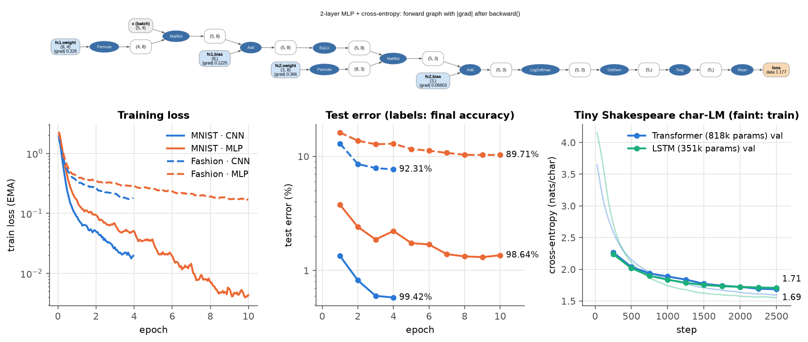
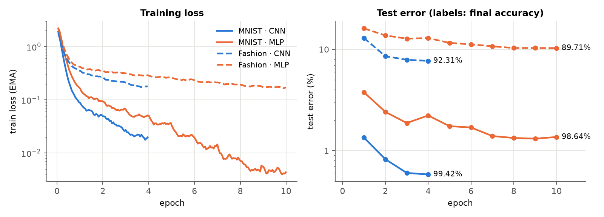
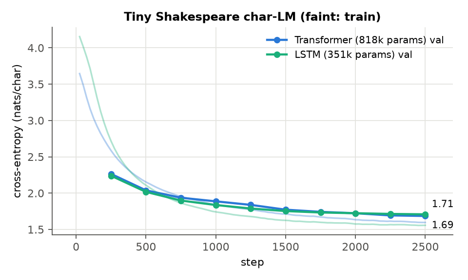
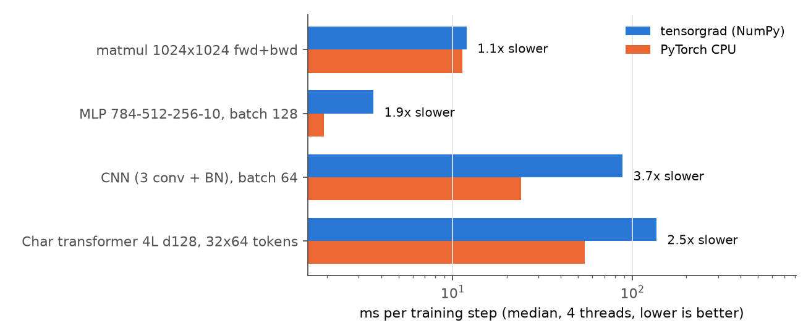
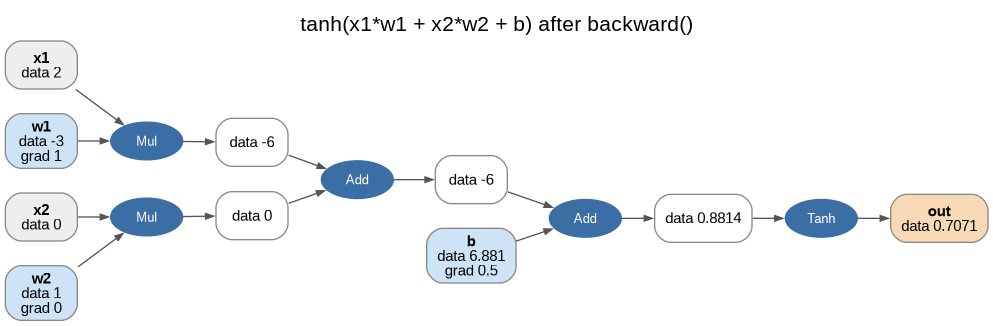

# tensorgrad

[](https://github.com/Jai-Advitheeya-Lella/tensorgrad/actions/workflows/tests.yml)

A small deep-learning framework written from scratch in NumPy: reverse-mode autodiff over a dynamic graph, a PyTorch-style `nn` / `optim` API, and enough operators to train CNNs and a character-level transformer on a CPU.



This is a from-scratch reimplementation for learning and research. It is not a PyTorch replacement; the benchmark section below measures how much slower it is.

## Highlights

- **Autodiff engine** (`tensor.py`): an n-dimensional `Tensor` whose operations record `Function` nodes on a dynamic DAG; `backward()` walks it in reverse topological order. Broadcasting is handled in one place: the engine sums any gradient back down to its input's shape, so individual ops never reason about it.
- **Operators**: matmul, elementwise and unary math, reductions, reshape / transpose / indexing (basic and advanced) / concat / stack / pad, `conv2d` via im2col with a single GEMM per pass, max and average pooling, fused softmax / log-softmax / logsumexp, dropout, layer norm and batch norm (with running statistics).
- **`nn.Module` API**: parameters, submodules, `state_dict` / `load_state_dict`, `train()` / `eval()`; Linear, Conv2d, Embedding, LayerNorm, BatchNorm1d/2d, pooling, multi-head causal attention, LSTM, activations and losses.
- **Optimisers and schedulers**: SGD (momentum, Nesterov), Adam, AdamW with parameter groups; step, exponential, cosine, lambda and warmup-cosine schedulers; gradient-norm clipping; a vectorised `DataLoader`.
- **Tests that check the maths**: 85 op specifications, each verified against central finite differences **and** against PyTorch forward values and input gradients in float64; plus layer parity with copied weights, optimiser trajectories, schedulers and data loading (303 tests, ~2 s).
- **Demos**: MLP and CNN on MNIST and Fashion-MNIST (99.42% on MNIST with the CNN) and a character-level transformer and LSTM on Tiny Shakespeare, all trained with this library only.
- **Graph visualisation**: `viz.draw_graph` renders any computation graph with Graphviz, optionally with values and gradients.

## Results

All numbers below come from runs on this machine (Intel Core Ultra 7 270K Plus, 24 cores; each run limited to 4 threads; no GPU is used). Seeds are fixed (`--seed 0`); each configuration was run once.

### Image classification

| Dataset | Model | Parameters | Epochs | Test accuracy | Wall clock |
|---|---|---:|---:|---:|---:|
| MNIST | MLP 784-512-256-10, dropout 0.1 | 535,818 | 10 | 98.64% | 26 s |
| MNIST | CNN (3 conv + BN, 2 pools, dropout 0.25) | 431,018 | 4 | **99.42%** | 1155 s |
| Fashion-MNIST | MLP | 535,818 | 10 | 89.71% | 26 s |
| Fashion-MNIST | CNN | 431,018 | 4 | 92.31% | 1160 s |

Accuracy is that of the final epoch on the 10,000-image test set (no checkpoint selection on test data). Setup: AdamW with decoupled weight decay on weight matrices only, linear warmup then cosine decay, batch size 128, inputs standardised, no data augmentation. The CNN runs were trained while the machine was shared with many other jobs, so their wall-clock time (the per-epoch time fell from 390 s to 220 s as load changed) is an upper bound; the step benchmark below was measured on an idle machine and is the better speed reference. The CNN is small and trained for only 4 epochs; longer training and augmentation would improve Fashion-MNIST further.



### Character-level language models (Tiny Shakespeare)

Both models are trained for 2,500 steps (batch 32, context 64 characters, AdamW, warmup + cosine, gradient clipping at 1.0) on the first 90% of the text; loss is measured on the held-out last 10% over 20 fixed batches.

| Model | Parameters | Validation loss (nats/char) | Train loss |
|---|---:|---:|---:|
| Transformer (4 layers, d=128, 4 heads, dropout 0.1) | 818,176 | **1.685** | 1.506 |
| LSTM (hidden 256) | 350,593 | 1.708 | 1.550 |

A uniform guess over the 65-character vocabulary would score 4.17 nats/char. After this short training the models produce Shakespeare-shaped text with mostly plausible words but little coherence, for example (transformer, temperature 0.8, prompt `ROMEO:`):

```
ROMEO:
Peacely, wife thou had on your gentlementleman scould
I have can thou prived your lostdomns:
To-but not good to tends the words beconself-which it
not in infesent with they country.
```



### Speed against PyTorch (CPU)

One full training step (forward, backward, Adam update) in float32 with 4 threads, median of 30 interleaved trials, on an idle machine (`scripts/benchmark.py`). PyTorch 2.11.0, NumPy 2.5.4.

| Case | tensorgrad | PyTorch | Slowdown |
|---|---:|---:|---:|
| matmul 1024x1024, forward + backward | 11.9 ms | 11.3 ms | 1.06x |
| MLP 784-512-256-10, batch 128 | 3.6 ms | 1.9 ms | 1.88x |
| CNN (3 conv + BN), batch 64 | 88.1 ms | 24.0 ms | 3.67x |
| Char transformer, 4 layers, d=128, 32x64 tokens | 136.0 ms | 54.5 ms | 2.49x |

Dense matmuls are within a few percent because both call the same BLAS. The gap grows with the number of small, memory-bound NumPy operations (every op allocates its output and its saved tensors) and with convolutions, where im2col materialises a large column matrix and col2im is a Python loop over kernel offsets; PyTorch fuses and parallelises these in C++. tensorgrad is useful for understanding and for small experiments, not for large-scale training.



### Computation graphs

`scripts/visualize_graph.py` renders the graph of any expression after `backward()`, annotated with values and gradients. The first graph is the classic single-neuron example from micrograd:



## How it works

**Tape-free dynamic graph.** Each differentiable op is a subclass of `Function` with a NumPy `forward` and a NumPy `backward`. `Function.apply` runs `forward` and, if any input requires a gradient, stores the instance on the output tensor. `Tensor.backward()` topologically sorts the graph reachable from the loss, seeds $\partial L/\partial L = 1$ and, for each node in reverse order, calls `backward` and accumulates the returned gradients into its inputs.

**Broadcasting.** NumPy broadcasting prepends axes and stretches size-1 axes; the adjoint of both is a sum. Whenever a gradient arrives with a different shape than the tensor it belongs to, the engine reduces it with `unbroadcast`, so `a + b` with shapes `(N, D)` and `(D,)` needs no special code in `Add.backward`.

**Convolution.** `conv2d` copies every receptive field into a column matrix $X_{col}\in\mathbb{R}^{CK_hK_w\times NHW'}$ and computes $Y = W X_{col}$ with $W$ the flattened kernel. The backward pass is two GEMMs, $\partial L/\partial W = \partial L/\partial Y\, X_{col}^\top$ and $\partial L/\partial X_{col} = W^\top \partial L/\partial Y$, followed by a col2im scatter-add.

**Normalisation and softmax.** Layer/batch norm and the softmax family are fused ops with hand-derived backward passes. For instance log-softmax uses $\partial L/\partial x = g - \mathrm{softmax}(x)\sum g$, which is numerically stable because it never exponentiates unshifted logits.

**Verification.** `tensorgrad.testing.gradcheck` perturbs every input element and compares $\langle \partial f/\partial x, w\rangle$ from central differences, $\big(f(x+\epsilon)-f(x-\epsilon)\big)/2\epsilon$, against the analytic gradient for a random projection $w$ of the output. The same op specifications are evaluated in PyTorch and the outputs and gradients compared.

## Quickstart

```bash
uv venv --python 3.12 .venv && source .venv/bin/activate
uv pip install -r requirements.txt && uv pip install -e . --no-deps

pytest -q                                              # 303 tests, ~2 s

# Demos (datasets are downloaded into data/ on first use)
python scripts/train_mnist.py --dataset mnist --model cnn --epochs 4
python scripts/train_mnist.py --dataset fashion --model mlp --epochs 10
python scripts/train_charlm.py --model transformer --steps 2500
python scripts/train_charlm.py --model lstm --steps 2500

python scripts/visualize_graph.py                      # graph PNGs in assets/ (needs the Graphviz `dot` binary)
python scripts/benchmark.py --trials 30                # speed vs PyTorch
python scripts/plot_results.py                         # figures from results/*.json
```

A minimal example:

```python
import numpy as np
import tensorgrad as tg
from tensorgrad import F, Tensor, nn, optim

model = nn.Sequential(nn.Linear(2, 16), nn.Tanh(), nn.Linear(16, 1))
opt = optim.Adam(model.parameters(), lr=1e-2)
x = Tensor(np.random.randn(256, 2).astype(np.float32))
y = Tensor((x.data[:, :1] * x.data[:, 1:]))
for _ in range(500):
    loss = F.mse_loss(model(x), y)
    opt.zero_grad(); loss.backward(); opt.step()
```

## Project structure

```
src/tensorgrad/
  tensor.py        Tensor, Function, autograd engine, no_grad, unbroadcast
  ops.py           Function subclasses: math, reductions, indexing, conv2d, pooling, norms
  functional.py    functional API (F.relu, F.softmax, F.conv2d, F.cross_entropy, ...)
  nn/              Module/Parameter, layers (Linear, Conv2d, LayerNorm, LSTM, attention, ...)
  optim/           SGD, Adam, AdamW, LR schedulers
  data.py          Dataset / DataLoader;  datasets.py  MNIST, Fashion-MNIST, Tiny Shakespeare
  models.py        MLP, ConvNet, CharTransformer, CharLSTM;  viz.py  Graphviz renderer
  testing.py       finite-difference gradcheck;  serialization.py  save / load (.npz)
tests/             gradcheck + PyTorch parity for 85 ops, layers, optimisers, data
scripts/           training, benchmark, visualisation and plotting entry points
results/           JSON logs of every run quoted above
assets/            figures
```

## References

- A. Karpathy, [micrograd](https://github.com/karpathy/micrograd): the tiny scalar autograd engine that inspired the graph design and the neuron example. No code was copied.
- G. Hotz et al., [tinygrad](https://github.com/tinygrad/tinygrad): inspiration for a small op set and a readable design.
- D. Rumelhart, G. Hinton, R. Williams, "Learning representations by back-propagating errors", Nature 323, 1986.
- D. Kingma, J. Ba, "Adam: A Method for Stochastic Optimization", [arXiv:1412.6980](https://arxiv.org/abs/1412.6980); I. Loshchilov, F. Hutter, "Decoupled Weight Decay Regularization", [arXiv:1711.05101](https://arxiv.org/abs/1711.05101).
- J. Ba, J. Kiros, G. Hinton, "Layer Normalization", [arXiv:1607.06450](https://arxiv.org/abs/1607.06450); S. Ioffe, C. Szegedy, "Batch Normalization", [arXiv:1502.03167](https://arxiv.org/abs/1502.03167).
- A. Vaswani et al., "Attention Is All You Need", [arXiv:1706.03762](https://arxiv.org/abs/1706.03762); S. Hochreiter, J. Schmidhuber, "Long Short-Term Memory", Neural Computation 9(8), 1997.

Released under the MIT License.
